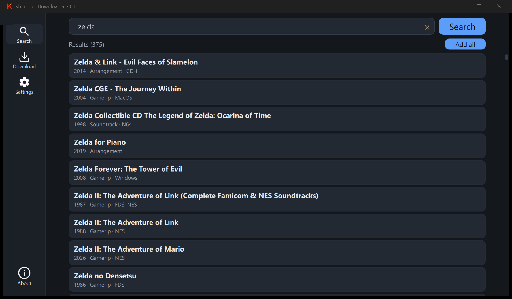

# KhinsiderDownloader

<div align="center">


[](https://github.com/FrankenSama/KhinsiderDownloader/actions/workflows/build.yml)
[](https://tooomm.github.io/github-release-stats/?username=FrankenSama&repository=KhinsiderDownloader)

**Search Khinsider and bulk-download entire soundtracks, with a clean desktop GUI.**



</div>

## Overview

KhinsiderDownloader is a desktop app for Windows and Linux that searches [downloads.khinsider.com](https://downloads.khinsider.com/) and downloads whole albums in bulk. Type an album or game name, pick the results you want, and the app queues every track through an async worker pool, so a full soundtrack downloads without clicking through the site track by track.

Built with C++ and Qt 6 (Quick/QML), it runs natively on both platforms, remembers your settings and window state, and keeps the interface responsive while downloads run in the background.

This is FrankenSama's maintained version of KhinsiderDownloader, developed independently with its own changes and release schedule. It is based on the original [KhinsiderDownloader](https://github.com/weespin/KhinsiderDownloader) by [Weespin](https://github.com/weespin) — many thanks for the original work.

## Features

- **Album search** with a live result list showing title, year, type, and platform
- **Bulk downloading** through a configurable async worker pool
- **Download queue** with live progress, per-album status, and a pending-count badge in the sidebar
- **Audio quality preference**: MP3 or the best format available for each album
- **Cover art** download and a skip-existing-files option
- **Configurable download folder**, thread count, and concurrent downloads per thread
- **Optional logging** with a one-click log folder
- **Compact dark UI** built with Qt Quick
- **Windows and Linux (AppImage) builds**
- **Keyboard-first navigation**: search from anywhere and switch tabs with `Ctrl+1`–`Ctrl+4`
- **Nightly development builds** alongside stable releases

## Install

**[Download the latest stable release](https://github.com/FrankenSama/KhinsiderDownloader/releases)** (recommended)

Windows builds ship as a ready-to-run folder or installer. On Linux, use the AppImage: make it executable (`chmod +x KhinsiderDownloader*.AppImage`) and run it.

Nightly builds from the `dev` branch are available as workflow artifacts through [nightly.link](https://nightly.link/FrankenSama/KhinsiderDownloader/workflows/build/dev).

## Usage

1. Open the **Search** tab and type an album or game name.
2. Pick an album from the results, or use **Add all** to queue every result.
3. Open the **Download** tab to watch progress, cancel downloads, or open the download folder.
4. Adjust the download folder, thread count, audio quality, cover art, and logging in **Settings**.

| Action | Shortcut |
|---|---|
| Focus search | `Ctrl+F` |
| Search tab | `Ctrl+1` |
| Download tab | `Ctrl+2` |
| Settings tab | `Ctrl+3` |
| About tab | `Ctrl+4` |

Downloads run asynchronously, and closing the window while work is still queued asks for confirmation first. The title bar shows live progress (`downloaded/total`), while the sidebar badge shows how many songs are still pending.

## Release Channels

| Channel | Branch | Description |
|---|---|---|
| **Stable** | `master` | Tested releases, cut from `master`. Recommended for normal use. |
| **Nightly** | `dev` | Latest development builds from `dev`. May be unstable or broken. |

Development happens on `dev`; changes are merged into `master` only when they are ready for a stable release.

## Building from Source

You need CMake 3.21+, Qt 6.12+, a C++17 compiler, and vcpkg for `curl` and `libxml2`.

```bash
git clone https://github.com/FrankenSama/KhinsiderDownloader.git --branch master
cd KhinsiderDownloader
mkdir build && cd build
cmake .. -DCMAKE_PREFIX_PATH="path/to/Qt" -DCMAKE_TOOLCHAIN_FILE="path/to/vcpkg/scripts/buildsystems/vcpkg.cmake"
cmake --build . --config Release
```

On Windows, `scripts/windows/fullbuild.bat` configures, builds, and deploys in one step. On Linux, use `scripts/linux/deploy.sh` after building. Full setup instructions, including Debian prerequisites and the optional parser tests, are in [CONTRIBUTING.md](CONTRIBUTING.md).

## Legal Disclaimer

This application downloads music directly from [downloads.khinsider.com](https://downloads.khinsider.com/). All music and related content are hosted and provided by that external website.

Like a torrent client, this application does not host or store any music files. It only facilitates the download process from the external source. All music content is subject to the terms and conditions of the copyright holders and the external website.

If you have a copyright concern or wish to file a DMCA notice, contact [Khinsider](https://downloads.khinsider.com/) directly. Please respect the intellectual property rights of artists and content creators.

## Contributing

Bug reports and focused pull requests are welcome. See [CONTRIBUTING.md](CONTRIBUTING.md) for development setup, coding standards, and the pull request process. If you use the app and like it, a star on GitHub is appreciated.

## License

[GPLv3](LICENSE) © 2025 Weespin, 2026 FrankenSama. If you fork or republish this project, keep the license and copyright notices, credit the original authors, and make it clear that your version is not the official build.

---

[GitHub](https://github.com/FrankenSama/KhinsiderDownloader) · [Releases](https://github.com/FrankenSama/KhinsiderDownloader/releases) · [Nightly builds](https://nightly.link/FrankenSama/KhinsiderDownloader/workflows/build/dev) · [Report an issue](https://github.com/FrankenSama/KhinsiderDownloader/issues)
